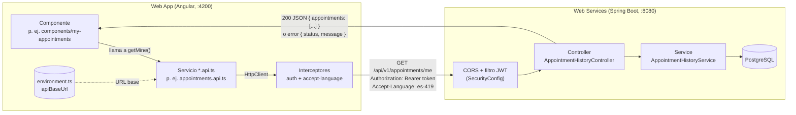
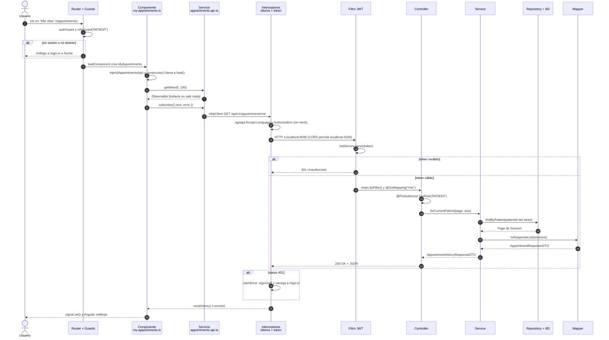

# FisioVital Web App

Web App de FisioVital (Sprint 2, TB3 de 1ACC0236 Ingeniería de Software, UPC 2026-20). Angular 22, TypeScript y
Angular Material 3, integrada con [fisiovital-web-services](https://github.com/Ravit18/fisiovital-web-services).

## Requisitos

- Node.js 22 o superior (probado con 24) y npm.
- El backend corriendo en `http://localhost:8080` (ver su README). Ya acepta CORS desde `http://localhost:4200`.

## Cómo correr

```bash
npm install
npm start          # http://localhost:4200
npm test           # Vitest
npm run build      # dist/fisiovital-web-app
```

La URL del backend está en `src/environments/environment.ts` (`apiBaseUrl`).

## Cómo se conecta con el backend

La Web App no guarda datos propios: todo lo pide al backend por HTTP (JSON) y solo dibuja la respuesta.



Las piezas que hacen la conexión:

| Pieza | Archivo | Qué hace |
|---|---|---|
| Dirección del backend | `src/environments/environment.ts` | `apiBaseUrl = http://localhost:8080/api/v1`. Para la nube (TB4) solo se cambia aquí. |
| Servicios de API | `services/*.api.ts` | Un método por endpoint, por ejemplo `getMine()` → `GET /appointments/me`. Son los únicos que usan `HttpClient`. |
| Modelos (DTO) | `model/*.entity.ts` y `model/*.request.ts` | Interfaces con los mismos campos que los DTO del backend: `*.entity.ts` ↔ `dto/response/*ResponseDTO` (lo que llega) y `*.request.ts` ↔ `dto/request/*RequestDTO` (lo que se envía). Cada interfaz dice en un comentario a qué DTO corresponde. |
| Token | `services/auth.interceptor.ts` | Agrega `Authorization: Bearer <token>` a cada llamada. Si el backend responde 401, cierra la sesión. |
| Idioma | `services/accept-language.interceptor.ts` | Envía `Accept-Language` (es-419/en-US) y el backend responde los mensajes en ese idioma. |
| Registro de interceptores | `src/app/app.config.ts` | `provideHttpClient(withInterceptors([...]))`. |
| Permiso del navegador (CORS) | Backend: `SecurityConfig.java` y `app.cors.allowed-origins` | Deja que `localhost` (cualquier puerto) llame a la API. En la nube se fija con `CORS_ALLOWED_ORIGINS`. |

Cada servicio del front corresponde a un controller del backend:

| Front (`*.api.ts`) | Backend (controller) | US |
|---|---|---|
| `services/auth.service.ts` | `AuthController` (`/auth`) | US01–US03 |
| `services/physiotherapists.api.ts` | `PhysiotherapistController` (`/physiotherapists`) | US04–US05 |
| `services/slots.api.ts` | `PhysiotherapistController` (`/{id}/slots`) y `MySlotsController` | US06–US07 |
| `services/agenda.api.ts` | `AgendaController` | US08 |
| `services/treatment-plans.api.ts` | `TreatmentPlanController` | US09–US10 + CRUD del plan (GET/PUT/DELETE `{id}`) |
| `services/sessions.api.ts` | `SessionController` | US11–US12 |
| `services/notifications.store.ts` | `NotificationController` | US13 |
| `services/appointments.api.ts` | `AppointmentHistoryController` | US14–US16 |
| `services/assistant.api.ts` | `AssistantController` | US17–US20 |

Para verlo en vivo, abre la app, presiona **F12 → Network (Red)**, filtra por `api/v1` y navega: cada fila es una
llamada al backend, con su URL, sus headers (token e idioma) y el JSON de respuesta.

**Si sale "No pudimos conectar con el servidor":** el backend no está corriendo en `:8080`, o la página se abrió
desde un origen que el CORS no permite. Revisa primero que `http://localhost:8080/swagger-ui.html` abra.

## Flujo completo de una petición (ejemplo: Mis citas, US14)

Requisito previo: el usuario ya inició sesión. `AuthService.signIn()` hizo `POST /auth/sign-in`, recibió el token
y lo guardó en el signal `session` y en `localStorage`.

### Flujograma

Se lee de arriba hacia abajo. Los rombos son decisiones; cada caja indica el archivo donde ocurre.

```mermaid
flowchart TD
    A(["Usuario hace clic en 'Mis citas'"]) --> B["Router busca la ruta /appointments<br/>app.routes.ts"]
    B --> C{"authGuard: ¿hay sesión?<br/>auth.guard.ts"}
    C -- No --> C1(["Redirige a /sign-in"])
    C -- Sí --> D{"roleGuard: ¿rol PATIENT?"}
    D -- No --> D1(["Redirige a /home"])
    D -- Sí --> E["loadComponent crea MyAppointments<br/>my-appointments.ts"]
    E --> F["inject(AppointmentsApi) y constructor() llama a load()"]
    F --> G["load(): loading.set(true) y llama a api.getMine(0, 100)"]
    G --> H["getMine() arma GET /api/v1/appointments/me y devuelve un Observable<br/>appointments.api.ts"]
    H --> I["El componente hace .subscribe(): recién aquí sale la petición"]
    I --> J["Interceptor de idioma agrega Accept-Language y llama a next()<br/>accept-language.interceptor.ts"]
    J --> K["Interceptor de token agrega Authorization: Bearer token y llama a next()<br/>auth.interceptor.ts"]
    K --> L{"¿CORS permite el origen localhost:4200?<br/>SecurityConfig.java"}
    L -- No --> ERR0["El navegador bloquea la respuesta: status 0"]
    L -- Sí --> M{"Filtro JWT: ¿token válido?<br/>JwtAuthenticationFilter + JwtService"}
    M -- No --> ERR401["401 Unauthorized"]
    M -- Sí --> N["Guarda userId y rol en el SecurityContext<br/>y llama a chain.doFilter()"]
    N --> O["DispatcherServlet encuentra @GetMapping('/me')<br/>AppointmentHistoryController.java"]
    O --> P{"@PreAuthorize: ¿rol PATIENT?"}
    P -- No --> ERR403["403 Forbidden"]
    P -- Sí --> Q["Service: obtiene el paciente desde el token<br/>AppointmentHistoryService + ProfileLookupService"]
    Q --> R["Repository: findByPatient() consulta PostgreSQL<br/>AppointmentRepository.java"]
    R --> S["Mapper: Session (entidad) a AppointmentResponseDTO<br/>AppointmentMapper.java"]
    S --> T["Controller: return ResponseEntity.ok(dto)<br/>Jackson lo convierte a JSON (200 OK)"]
    T --> V{"¿La respuesta es un error?"}
    ERR0 --> V
    ERR401 --> V
    ERR403 --> V
    V -- "Sí, 401" --> W["catchError del authInterceptor:<br/>signOut() y navega a /sign-in"]
    V -- "Sí, otro" --> X["callback error del subscribe:<br/>errorMessage.set(apiErrorMessage(e))"]
    V -- "No, 200" --> Y["callback next del subscribe:<br/>appointments.set(history.appointments)"]
    W --> X
    X --> Z(["El signal avisa a Angular y se redibuja la pantalla<br/>(mensaje de error o tabla con @for)"])
    Y --> Z

    classDef front fill:#e7f2e3,stroke:#4d7d3b,color:#22352a
    classDef back fill:#e8eef7,stroke:#3b5d7d,color:#1f2f40
    classDef error fill:#fde9e7,stroke:#9d2e25,color:#69251f
    class A,B,C,D,E,F,G,H,I,J,K,V,W,X,Y,Z front
    class L,M,N,O,P,Q,R,S,T back
    class C1,D1,ERR0,ERR401,ERR403 error
```



Verde = front (Angular) · azul = backend (Spring Boot) · rojo = corte o error.

### Diagrama de secuencia (el mismo flujo en el tiempo)

Cada columna es una pieza del sistema. Una flecha llena es una llamada y una punteada, una respuesta.



## Estructura

Una carpeta por capa, como en la Semana 10 del curso y como el backend (Semana 5). Sin subcarpetas por módulo:

```
src/app/
├── app.config.ts    providers globales: router, HttpClient + interceptores, i18n, animaciones
├── app.routes.ts    rutas con loadComponent y guards
├── components/      componentes standalone (vistas enrutables y reutilizables), uno por carpeta
├── services/        *.api.ts (HttpClient), AuthService, guards, interceptores, stores, idioma, avisos
├── model/           interfaces con los campos de los DTO del backend (*.entity.ts ↔ response, *.request.ts ↔ request)
├── styles/          guía de estilo (colores y fuentes) y estilos compartidos de las páginas de listas
└── utils/           utilidades de fechas
```

| Módulo (US) | Componentes | Servicios |
|---|---|---|
| IAM (US01–03) | `sign-in`, `sign-up` | `auth.service`, `auth.guard`, `auth.interceptor` |
| Perfiles (US04–05) | `physiotherapist-search`, `physiotherapist-profile` | `physiotherapists.api` |
| Horarios (US06–07) | `slot-picker`, `publish-slots` | `slots.api` |
| Tratamiento (US08–12) | `treatment-plans`, `agenda`, `edit-plan-dialog`, `reschedule-dialog` | `treatment-plans.api`, `sessions.api`, `agenda.api` |
| Notificaciones (US13) | `notifications` | `notifications.store`, `notification.service` |
| Citas (US14–16) | `my-appointments`, `patient-history` | `appointments.api` |
| Asistente (US17–20) | `assistant-chat` | `assistant.api` |
| Comunes | `layout`, `landing`, `home`, `terms`, `not-found`, `confirm-dialog`, `language-switcher`, `session-status-chip` | `language.service`, `feedback.service`, `accept-language.interceptor` |

## Cómo se aplica la teoría del curso

### Semana 9: diseño de interfaz y fundamentos de Angular

| Tema | Dónde |
|---|---|
| Guía de estilo (colores, tipografía) | `styles/_style-guide.scss`: la paleta del mock-up de Figma como variables CSS (`--fv-color-primary`, `--fv-font-display`…). Los componentes usan `var(--fv-…)`, nunca un HEX suelto. Si cambias un valor ahí, cambia en todas las pantallas, igual que al editar el componente principal en Figma. |
| Componentes de diseño reutilizables | `confirm-dialog`, `session-status-chip`, `slot-picker` y `language-switcher` se usan en varias vistas |
| Anatomía de un componente: clase, template y selector | Cada carpeta de `components/`: `@Component({ selector: 'app-agenda', templateUrl, styleUrl })` y su clase `AgendaPage` |
| Interpolación `{{ }}` y property binding `[ ]` | Ejemplo: `<app-session-status-chip [status]="appointment.status" />` en `my-appointments.html` |
| Signals: `signal`, `computed`, `effect` | `signal()` para el estado de cada vista; `computed()` en `agenda.ts` (semana y citas); `effect()` en `services/language.service.ts` (al cambiar el idioma actualiza las traducciones, `<html lang>` y `localStorage`) |
| Árbol de componentes | `app.ts` (raíz, `<app-layout />`) → `layout` (barra y `<router-outlet />`) → la vista de cada ruta → hijos como `session-status-chip` |
| Servicios con `inject()` | `services/`: lógica y datos compartidos entre componentes |
| Enrutamiento | `app.routes.ts`: cada URL con su componente (`loadComponent`) y sus guards |

### Semana 10: arquitectura frontend y consumo de APIs

| Tema | Dónde |
|---|---|
| Componentes standalone con `imports` e `inject()` | Todos los de `components/` (las dependencias van con `inject()`, no por constructor) |
| Servicio con `HttpClient` que devuelve `Observable<T>` | `services/*.api.ts` |
| Formularios reactivos (`FormGroup`, `FormControl`, `Validators`) | `sign-in`, `sign-up`, `publish-slots`, `edit-plan-dialog`, `physiotherapist-profile` |
| Manejo de errores (`HttpErrorResponse`, mensaje según el código) | `model/api-error.ts` (`apiErrorMessage`) y el callback `error` de cada componente; `catchError` en `auth.interceptor.ts` |
| JWT: interceptor, `localStorage` y guards | `auth.interceptor.ts`, `auth.service.ts` (guarda la sesión), `auth.guard.ts` |
| Diseño responsive | `@media` en los `.scss` de `landing`, `home`, `agenda` y en `styles/_page.scss` |

### Semana 11: guion para la sustentación (máx. 12 min, todos intervienen)

1. **Ricardo (base):** estructura por capas, `app.config.ts`, `app.routes.ts`, guía de estilo, `signal`/`computed`/`effect`,
   flujo JWT (login → token → interceptor → guards), i18n y Landing.
2. **Chris (US13–US16):** `my-appointments`, `patient-history` y `notifications`. Explica un servicio `*.api.ts` con
   `HttpClient` y cómo se muestra el `message` de error del backend.
3. **Gabriel (US04–US05, US17–US20):** búsqueda y perfil del fisioterapeuta, y el chat con el asistente IA.
4. **Franco (US06–US12):** horarios (`slot-picker`), planes, reserva, reprogramar y cancelar. Explica un formulario
   reactivo con `Validators`.

Para la demo en vivo: backend levantado, `seed-demo.ps1` corrido y **F12 → Network** para mostrar la llamada, el
token y el JSON (ver "Cómo se conecta con el backend").

## Historias de usuario en la Web App

| US | Rol | Dónde |
|---|---|---|
| US01 Registro de paciente | Visitante | `/sign-up` (Paciente); entra directo al terminar |
| US02 Registro de fisioterapeuta | Visitante | `/sign-up` (Fisioterapeuta): colegiatura, especialidad, experiencia |
| US03 Inicio de sesión (bloqueo tras 5 intentos) | Visitante | `/sign-in`; muestra el mensaje del backend |
| US04 Buscar por especialidad | Paciente | `/physiotherapists` |
| US05 Perfil del fisioterapeuta | Paciente | `/physiotherapists/:id` |
| US06 Horarios libres / siguiente semana disponible | Paciente | Perfil → "Horarios disponibles" |
| US07 Publicar horarios | Fisioterapeuta | `/availability` |
| US08 Agenda diaria | Fisioterapeuta | `/agenda` |
| US09 Plan de tratamiento | Paciente | Perfil → "Tu plan de tratamiento"; `/treatment-plans` (editar y eliminar plan) |
| US10 Reservar sesión (409 si otro la tomó) | Paciente | Perfil → elegir horario → confirmar |
| US11 Reprogramar (cambio tardío < 24 h) | Paciente | `/appointments` → Reprogramar |
| US12 Cancelar (`LATE_CANCELLED` < 24 h) | Paciente | `/appointments` → Cancelar |
| US13 Notificaciones y recordatorios | Ambos | Campana de la barra y `/notifications` |
| US14 Historial del paciente (paginado, 503) | Paciente | `/appointments` (Próximas / Historial, "Cargar más") |
| US15 Historial del fisioterapeuta | Fisioterapeuta | `/patients` |
| US16 Historial de un paciente | Fisioterapeuta | `/patients` → buscar por nombre completo |
| US17–US20 Asistente IA (dudas, especialista, reservar, reprogramar) | Ambos (reservar y reprogramar: paciente) | `/assistant` |

## i18n y accesibilidad

- Idiomas `es-419` (por defecto) y `en-US` con ngx-translate. Los textos están en `public/i18n/*.json`; usar siempre
  claves (`{{ 'iam.signIn.title' | translate }}`), nunca texto fijo en las plantillas.
- `acceptLanguageInterceptor` envía el idioma elegido en `Accept-Language`, así los errores del backend
  (`{status, message, details}`) llegan ya traducidos y se muestran tal cual.
- ARIA: enlace "Saltar al contenido", `aria-label` en botones de solo ícono, `role="alert"` en errores y
  `<html lang>` sincronizado con el idioma.

## Cuentas de prueba

El backend arranca sin datos. Para crear estas cuentas con sus horarios, planes y citas, corre una vez en
`fisiovital-web-services` (con el backend encendido):

```bash
powershell -ExecutionPolicy Bypass -File scripts\seed-demo.ps1
```

Todas usan la contraseña **`Demo2026*`**. Son datos ficticios solo para desarrollo local (correos `@example.com`).

| Rol | Correo | Qué vas a ver |
|---|---|---|
| Paciente | `carlos.mendoza@example.com` | 6 citas con dos fisioterapeutas (Mariana y Jorge) |
| Paciente | `ana.torres@example.com` | Citas próximas y canceladas en el historial |
| Paciente | `luis.quispe@example.com` | Una cita reprogramada |
| Paciente | `sofia.huaman@example.com` | Plan de rehabilitación neurológica de 20 sesiones |
| Fisioterapeuta | `mariana.rojas@example.com` | Agenda con Carlos y Ana (deportiva) |
| Fisioterapeuta | `jorge.paredes@example.com` | Agenda con Carlos y Luis (columna y postura) |
| Fisioterapeuta | `lucia.vargas@example.com` | Agenda con Sofía (neurológica) |

Los horarios se publican desde el día siguiente a la carga: en **Mi agenda** usa "Semana siguiente" si hoy
aparece vacío.
