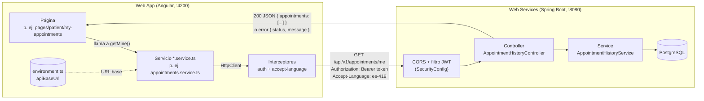
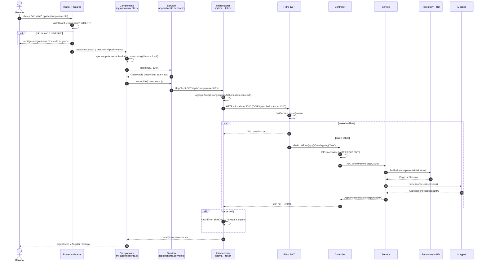

# FisioVital Web App

Web App de FisioVital (Sprint 2, TB3 de 1ACC0236 Ingeniería de Software, UPC 2026-20). Angular 22, TypeScript y
Angular Material 3, integrada con [fisiovital-web-services](https://github.com/Ravit18/fisiovital-web-services).

## Requisitos

- Node.js 22 o superior (probado con 24) y npm.
- El backend corriendo en `http://localhost:8080` (ver su README). Ya acepta CORS desde `http://localhost:4200`.

## Cómo correr

```bash
npm install
npm start          # http://localhost:4200
npm test           # Vitest
npm run build      # dist/fisiovital-web-app
```

La URL del backend está en `src/environments/environment.ts` (`apiBaseUrl`, local). En producción `ng build` usa
`src/environments/environment.prod.ts` (backend en Render).

## Despliegue

| Producto | Servicio | URL |
|---|---|---|
| Web App (y landing en `home/`) | Netlify | https://fisiovitalupc.netlify.app |
| Web Services | Render (Docker) | https://fisiovital-web-services.onrender.com/swagger-ui/index.html |
| Base de datos | Supabase (PostgreSQL) | — |

Pipeline CI/CD en `.github/workflows/ci-cd.yml` (GitHub Actions): **Commit → Build → Test → Deploy**.

- En cada push o Pull Request a `develop` o `main`: `npm ci`, pruebas (`ng test`) y `ng build` de producción.
- Solo en push a `main` y si todo pasó: publica `dist/fisiovital-web-app/browser` en Netlify.
- Secretos del repo (Settings → Secrets and variables → Actions): `NETLIFY_AUTH_TOKEN` y `NETLIFY_SITE_ID`.
- En Netlify los builds automáticos están apagados ("Builds are stopped"): no activarlos, despliega solo Actions.
- `public/_redirects` hace que las rutas de Angular (`/sign-in`, `/patient/...`) funcionen al recargar.

## Cómo hacer cambios (GitFlow)

```
feat/mi-cambio ──PR──► develop ──PR──► main ──► se despliega solo en Netlify
                  (corre pruebas)
```

1. Partir de `develop` actualizado y crear tu rama:
   ```bash
   git switch develop
   git pull
   git switch -c feat/nombre-del-cambio
   ```
2. Hacer los cambios y probarlos: `npm start` (con el backend local) y `npm test`.
3. Revisar con `git status` que no aparezcan `node_modules/`, `dist/`, `.angular/` ni `.env`. Luego:
   ```bash
   git add .
   git commit -m "feat: descripción corta"
   git push -u origin feat/nombre-del-cambio
   ```
4. En GitHub, abrir un PR hacia `develop`. Si Actions sale en verde, **Merge**.
5. Para publicar, abrir un PR de `develop` hacia `main` y hacer **Merge**. En 1–2 min está en Netlify.
6. Si Actions sale en rojo no se despliega nada (sigue la versión anterior): abrir el run para ver el error.

Si cambia la URL del backend, editar `environment.prod.ts` y, en Render, agregar la URL del front a
`CORS_ALLOWED_ORIGINS`.

## Cómo se conecta con el backend

La Web App no guarda datos propios: todo lo pide al backend por HTTP (JSON) y solo dibuja la respuesta.



Las piezas que hacen la conexión:

| Pieza | Archivo | Qué hace |
|---|---|---|
| Dirección del backend | `src/environments/environment.ts` | `apiBaseUrl = http://localhost:8080/api/v1`. Para la nube (TB4) solo se cambia aquí. |
| Servicios de API | `core/services/*.service.ts` | Un método por endpoint, por ejemplo `getMine()` → `GET /appointments/me`. Son los únicos que usan `HttpClient`. |
| Modelos (DTO) | `core/models/*.model.ts` y `core/models/*-request.model.ts` | Interfaces con los mismos campos que los DTO del backend: `*.model.ts` ↔ `dto/response/*ResponseDTO` (lo que llega) y `*-request.model.ts` ↔ `dto/request/*RequestDTO` (lo que se envía). Cada interfaz dice en un comentario a qué DTO corresponde. |
| Token | `core/interceptors/auth.interceptor.ts` | Agrega `Authorization: Bearer <token>` a cada llamada. Si el backend responde 401, cierra la sesión. |
| Idioma | `core/interceptors/accept-language.interceptor.ts` | Envía `Accept-Language` (es-419/en-US) y el backend responde los mensajes en ese idioma. |
| Registro de interceptores | `src/app/app.config.ts` | `provideHttpClient(withInterceptors([...]))`. |
| Permiso del navegador (CORS) | Backend: `config/CorsConfig.java` (activado en `SecurityConfig`) y `app.cors.allowed-origins` | Deja que `localhost` (cualquier puerto) llame a la API. En la nube se fija con `CORS_ALLOWED_ORIGINS`. |

Cada servicio del front corresponde a un controller del backend:

| Front (`*.service.ts`) | Backend (controller) | US |
|---|---|---|
| `core/services/auth.service.ts` | `AuthController` (`/auth`) | US01–US03 |
| `core/services/physiotherapists.service.ts` | `PhysiotherapistController` (`/patient/physiotherapists`) | US04–US05 |
| `core/services/slots.service.ts` | `PhysiotherapistController` (`/{id}/slots`) y `MySlotsController` | US06–US07 |
| `core/services/agenda.service.ts` | `AgendaController` | US08 |
| `core/services/treatment-plans.service.ts` | `TreatmentPlanController` | US09–US10 + CRUD del plan (GET/PUT/DELETE `{id}`) |
| `core/services/sessions.service.ts` | `SessionController` | US11–US12 |
| `core/services/notifications.store.ts` | `NotificationController` | US13 |
| `core/services/appointments.service.ts` | `AppointmentHistoryController` | US14–US16 |
| `core/services/assistant.service.ts` | `AssistantController` | US17–US20 |
| `core/services/clinical-notes.service.ts` | `ClinicalNoteController` | Historia clínica (ficha del paciente) |

Para verlo en vivo, abre la app, presiona **F12 → Network (Red)**, filtra por `api/v1` y navega: cada fila es una
llamada al backend, con su URL, sus headers (token e idioma) y el JSON de respuesta.

**Si sale "No pudimos conectar con el servidor":** el backend no está corriendo en `:8080`, o la página se abrió
desde un origen que el CORS no permite. Revisa primero que `http://localhost:8080/swagger-ui.html` abra.

## Flujo completo de una petición (ejemplo: Mis citas, US14)

Requisito previo: el usuario ya inició sesión. `AuthService.signIn()` hizo `POST /auth/sign-in`, recibió el token
y lo guardó en el signal `session` y en `localStorage`.

### Flujograma

Se lee de arriba hacia abajo. Los rombos son decisiones; cada caja indica el archivo donde ocurre.

```mermaid
flowchart TD
    A(["Usuario hace clic en 'Mis citas'"]) --> B["Router busca /patient/appointments: grupo patient<br/>app.routes.ts y patient.routes.ts"]
    B --> C{"canActivateChild del grupo<br/>authGuard: ¿hay sesión?"}
    C -- No --> C1(["Redirige a /sign-in"])
    C -- Sí --> D{"roleGuard: ¿rol PATIENT?"}
    D -- No --> D1(["Redirige a /patient/home"])
    D -- Sí --> E["Se crea MainLayout (barra y menú)<br/>y dentro la página MyAppointments<br/>pages/patient/my-appointments"]
    E --> F["inject(AppointmentsService) y constructor() llama a load()"]
    F --> G["load(): loading.set(true) y llama a api.getMine(0, 100)"]
    G --> H["getMine() arma GET /api/v1/appointments/me y devuelve un Observable<br/>appointments.service.ts"]
    H --> I["El componente hace .subscribe(): recién aquí sale la petición"]
    I --> J["Interceptor de idioma agrega Accept-Language y llama a next()<br/>accept-language.interceptor.ts"]
    J --> K["Interceptor de token agrega Authorization: Bearer token y llama a next()<br/>auth.interceptor.ts"]
    K --> L{"¿CORS permite el origen localhost:4200?<br/>CorsConfig.java"}
    L -- No --> ERR0["El navegador bloquea la respuesta: status 0"]
    L -- Sí --> M{"Filtro JWT: ¿token válido?<br/>JwtAuthenticationFilter + JwtService"}
    M -- No --> ERR401["401 Unauthorized"]
    M -- Sí --> N["Guarda userId y rol en el SecurityContext<br/>y llama a chain.doFilter()"]
    N --> O["DispatcherServlet encuentra @GetMapping('/me')<br/>AppointmentHistoryController.java"]
    O --> P{"@PreAuthorize: ¿rol PATIENT?"}
    P -- No --> ERR403["403 Forbidden"]
    P -- Sí --> Q["Service: obtiene el paciente desde el token<br/>AppointmentHistoryService + ProfileLookupService"]
    Q --> R["Repository: findByPatient() consulta PostgreSQL<br/>AppointmentRepository.java"]
    R --> S["Mapper: Session (entidad) a AppointmentResponseDTO<br/>AppointmentMapper.java"]
    S --> T["Controller: return ResponseEntity.ok(dto)<br/>Jackson lo convierte a JSON (200 OK)"]
    T --> V{"¿La respuesta es un error?"}
    ERR0 --> V
    ERR401 --> V
    ERR403 --> V
    V -- "Sí, 401" --> W["catchError del authInterceptor:<br/>signOut() y navega a /sign-in"]
    V -- "Sí, otro" --> X["callback error del subscribe:<br/>errorMessage.set(apiErrorMessage(e))"]
    V -- "No, 200" --> Y["callback next del subscribe:<br/>appointments.set(history.appointments)"]
    W --> X
    X --> Z(["El signal avisa a Angular y se redibuja la pantalla<br/>(mensaje de error o tabla con @for)"])
    Y --> Z

    classDef front fill:#e7f2e3,stroke:#4d7d3b,color:#22352a
    classDef back fill:#e8eef7,stroke:#3b5d7d,color:#1f2f40
    classDef error fill:#fde9e7,stroke:#9d2e25,color:#69251f
    class A,B,C,D,E,F,G,H,I,J,K,V,W,X,Y,Z front
    class L,M,N,O,P,Q,R,S,T back
    class C1,D1,ERR0,ERR401,ERR403 error
```



Verde = front (Angular) · azul = backend (Spring Boot) · rojo = corte o error.

### Flujograma con código

El mismo flujo, con la letra de cada caja, el archivo, la línea de código que se ejecuta y, debajo, qué hace.

```mermaid
flowchart TD
    A(["<b>A · patient-layout.html</b><br/>&lt;a [routerLink]='link.path'&gt;<br/><i>el enlace avisa al Router sin recargar la página</i>"])
    A --> B["<b>B · app.routes.ts y patient.routes.ts</b><br/>loadChildren: () => import('./pages/patient/patient.routes')<br/>path: 'appointments', loadComponent: ... MyAppointments<br/><i>busca la ruta y descarga la página solo cuando se necesita</i>"]
    B --> C{{"<b>C · auth.guard.ts</b><br/>auth.isSignedIn() || createUrlTree(['/sign-in'])<br/><i>¿hay sesión?</i>"}}
    C -- false --> C1(["Router va a /sign-in"])
    C -- true --> D{{"<b>D · auth.guard.ts</b><br/>currentUser()?.role === 'PATIENT'<br/><i>¿es paciente?</i>"}}
    D -- false --> D1(["Router va a /physiotherapist/home"])
    D -- true --> E["<b>E · patient-layout.html</b><br/>&lt;router-outlet /&gt;<br/><i>dibuja barra y menú, y pone la página en el hueco</i>"]
    E --> F["<b>F · my-appointments.ts</b><br/>private readonly api = inject(AppointmentsService)<br/>constructor() { this.load(); }<br/><i>recibe el servicio y pide las citas al abrir</i>"]
    F --> G["<b>G · my-appointments.ts</b><br/>this.loading.set(true)<br/>this.api.getMine(this.page, this.pageSize)<br/><i>muestra 'Cargando…' y llama al servicio</i>"]
    G --> H["<b>H · appointments.service.ts</b><br/>params = new HttpParams().set('page', page).set('size', size)<br/>return this.http.get&lt;AppointmentHistory&gt;(baseUrl + '/me', { params })<br/><i>arma GET /api/v1/appointments/me?page=0&size=100 (aún no sale)</i>"]
    H --> I["<b>I · my-appointments.ts</b><br/>.subscribe({ next: ..., error: ... })<br/><i>recién aquí se envía; next y error se ejecutan después</i>"]
    I --> J["<b>J · accept-language.interceptor.ts</b><br/>next(request.clone({ setHeaders: { 'Accept-Language': language } }))<br/><i>copia la petición y le agrega el idioma</i>"]
    J --> K["<b>K · auth.interceptor.ts</b><br/>request.clone({ setHeaders: { Authorization: 'Bearer ' + token } })<br/><i>agrega el token y la petición sale por la red</i>"]
    K --> L{{"<b>L · CorsConfig.java</b><br/>allowedOriginPatterns: http://localhost:*<br/><i>¿el backend acepta el origen :4200?</i>"}}
    L -- No --> ERR0["status 0<br/><i>el navegador bloquea la respuesta</i>"]
    L -- Sí --> M{{"<b>M · JwtAuthenticationFilter / JwtService</b><br/>Jwts.parser().verifyWith(key)...parseSignedClaims(token)<br/><i>¿la firma es correcta y no venció?</i>"}}
    M -- No --> ERR401["401 Unauthorized"]
    M -- Sí --> N["<b>N · JwtAuthenticationFilter.java</b><br/>SecurityContextHolder.getContext().setAuthentication(auth)<br/>chain.doFilter(request, response)<br/><i>guarda userId y ROLE_PATIENT y deja pasar la petición</i>"]
    N --> O["<b>O · AppointmentHistoryController.java</b><br/>@GetMapping(#quot;/me#quot;)<br/>forCurrentPatient(@RequestParam page, @RequestParam size)<br/><i>este método atiende GET /appointments/me</i>"]
    O --> P{{"<b>P · AppointmentHistoryController.java</b><br/>@PreAuthorize(#quot;hasRole('PATIENT')#quot;)<br/><i>¿el rol guardado en N es paciente?</i>"}}
    P -- No --> ERR403["403 Forbidden"]
    P -- Sí --> Q["<b>Q · AppointmentHistoryService.java</b><br/>Long patientId = profileLookupService.currentPatient().getId()<br/><i>saca al paciente del token, no de la URL</i>"]
    Q --> R["<b>R · AppointmentRepository.java</b><br/>findByPatient(patientId, PageRequest.of(page, size))<br/><i>consulta la BD y devuelve entidades Session</i>"]
    R --> S["<b>S · AppointmentMapper.java</b><br/>@Mapping(target = 'physiotherapistName', source = 'plan.physiotherapist.fullName')<br/>toResponseList(sessions, now)<br/><i>convierte cada entidad en un DTO plano</i>"]
    S --> T["<b>T · AppointmentHistoryController.java</b><br/>return ResponseEntity.ok(dto)<br/><i>200 OK; Jackson convierte el DTO a JSON</i>"]
    T --> V{{"<b>V · HttpClient</b><br/><i>¿el status es 200?</i>"}}
    ERR0 --> V
    ERR401 --> V
    ERR403 --> V
    V -- "No, 401" --> W["<b>W · auth.interceptor.ts</b><br/>catchError: if (error.status === 401 && token)<br/>auth.signOut(); router.navigate(['/sign-in'])<br/><i>cierra la sesión y manda al login</i>"]
    V -- "No, otro" --> X["<b>X · my-appointments.ts</b><br/>error: (e) => this.errorMessage.set(apiErrorMessage(e))<br/><i>guarda el message traducido del backend (o null si status 0)</i>"]
    V -- "Sí, 200" --> Y["<b>Y · my-appointments.ts</b><br/>next: (history) => this.appointments.set(history.appointments)<br/><i>guarda las citas y quita el 'Cargando…'</i>"]
    W --> X
    X --> Z(["<b>Z · my-appointments.html</b><br/>@for (appointment of history(); track appointment.sessionId)<br/>{{ appointment.physiotherapistName }}<br/><i>el signal cambió y Angular redibuja la tabla o el error</i>"])
    Y --> Z

    classDef front fill:#e7f2e3,stroke:#4d7d3b,color:#22352a,text-align:left
    classDef back fill:#e8eef7,stroke:#3b5d7d,color:#1f2f40,text-align:left
    classDef error fill:#fde9e7,stroke:#9d2e25,color:#69251f
    class A,B,C,D,E,F,G,H,I,J,K,V,W,X,Y,Z front
    class L,M,N,O,P,Q,R,S,T back
    class C1,D1,ERR0,ERR401,ERR403 error
```



### Diagrama de secuencia (el mismo flujo en el tiempo)

Cada columna es una pieza del sistema. Una flecha llena es una llamada y una punteada, una respuesta.



## Estructura

Igual que el ejemplo del curso (`event_sales`): la landing en `home/`, un layout por grupo en `layouts/`, las
pantallas en `pages/<grupo>/` (URL con el nombre del grupo: `/patient/...`, `/physiotherapist/...`) y todo lo que
no es pantalla en `core/`. Las reglas completas están en `AGENTS.md`.

```
src/app/
├── app.ts · app.config.ts · app.routes.ts   raíz, providers globales y rutas ("/" + un grupo por layout)
├── home/                                    landing pública en "/" (sin layout)
├── layouts/
│   ├── auth-layout/                         sign-in, sign-up, terms y 404: sin barra ni menú
│   ├── patient-layout/                      barra, menú del paciente, notificaciones y pie
│   └── physiotherapist-layout/              barra, menú del fisioterapeuta, notificaciones y pie
├── pages/
│   ├── auth/            auth.routes.ts            sign-in, sign-up (+ terms y not-found de common)
│   ├── patient/         patient.routes.ts         physiotherapist-search, physiotherapist-profile (+ slot-picker),
│   │                                              treatment-plans (+ edit-plan-dialog), my-appointments (+ reschedule-dialog)
│   ├── physiotherapist/ physiotherapist.routes.ts publish-slots, agenda, patient-history
│   └── common/          common.routes.ts          dashboard, notifications, assistant-chat (se montan en los dos grupos)
├── core/
│   ├── components/      piezas usadas por varias páginas: confirm-dialog, session-status-chip, language-switcher
│   ├── guards/          authGuard, guestGuard, roleGuard
│   ├── interceptors/    token (auth) e idioma (accept-language)
│   ├── models/          interfaces con los campos de los DTO del backend (*.model.ts ↔ response, *-request.model.ts ↔ request)
│   ├── services/        *.service.ts (HttpClient), AuthService, stores, idioma, avisos
│   └── dates.ts         utilidades de fechas
└── styles/              guía de estilo, estilos compartidos de listas y de los layouts (app-layout.scss)
```

| Grupo (guard) | URL | Página | US |
|---|---|---|---|
| — | `/` | `home/` (landing) | — |
| auth (`guestGuard`) | `/sign-in`, `/sign-up` | `sign-in`, `sign-up` | US01–US03 |
| patient (`authGuard` + `roleGuard('PATIENT')`) | `/patient/physiotherapists`, `/patient/physiotherapists/:id` | `physiotherapist-search`, `physiotherapist-profile` | US04–US06, US09–US10 |
| | `/patient/treatment-plans`, `/patient/appointments` | `treatment-plans`, `my-appointments` | US09, US11–US12, US14 |
| physiotherapist (`authGuard` + `roleGuard('PHYSIOTHERAPIST')`) | `/physiotherapist/availability`, `/physiotherapist/agenda`, `/physiotherapist/patients` | `publish-slots`, `agenda`, `patient-history` | US07, US08, US15–US16 |
| common (dentro de cada grupo) | `/<grupo>/home`, `/<grupo>/notifications`, `/<grupo>/assistant` | `dashboard`, `notifications`, `assistant-chat` | US13, US17–US20 |
| público | `/terms`, cualquier otra | `terms`, `not-found` | — |

## Cómo se aplica la teoría del curso

### Semana 9: diseño de interfaz y fundamentos de Angular

| Tema | Dónde |
|---|---|
| Guía de estilo (colores, tipografía) | `styles/_style-guide.scss`: la paleta del mock-up de Figma como variables CSS (`--fv-color-primary`, `--fv-font-display`…). Los componentes usan `var(--fv-…)`, nunca un HEX suelto. Si cambias un valor ahí, cambia en todas las pantallas, igual que al editar el componente principal en Figma. |
| Componentes de diseño reutilizables | `confirm-dialog`, `session-status-chip`, `slot-picker` y `language-switcher` se usan en varias vistas |
| Anatomía de un componente: clase, template y selector | Cada carpeta de `pages/`: `@Component({ selector: 'app-agenda', templateUrl, styleUrl })` y su clase `AgendaPage` |
| Interpolación `{{ }}` y property binding `[ ]` | Ejemplo: `<app-session-status-chip [status]="appointment.status" />` en `my-appointments.html` |
| Signals: `signal`, `computed`, `effect` | `signal()` para el estado de cada vista; `computed()` en `agenda.ts` (semana y citas); `effect()` en `core/services/language.service.ts` (al cambiar el idioma actualiza las traducciones, `<html lang>` y `localStorage`) |
| Árbol de componentes | `app.ts` (raíz, `<router-outlet />`) → layout del grupo (`patient-layout` o `physiotherapist-layout`: barra, menú y otro `<router-outlet />`) → la página de la ruta → hijos como `session-status-chip` |
| Servicios con `inject()` | `core/services/`: lógica y datos compartidos entre componentes |
| Enrutamiento | `app.routes.ts`: `/` carga `home/` (landing) y cada grupo carga su layout y su `*.routes.ts` con `loadChildren`; los guards van por grupo (`canActivate` en `app.routes.ts`) |

### Semana 10: arquitectura frontend y consumo de APIs

| Tema | Dónde |
|---|---|
| Componentes standalone con `imports` e `inject()` | Todas las páginas de `pages/` y las piezas de `core/components/` (las dependencias van con `inject()`, no por constructor) |
| Servicio con `HttpClient` que devuelve `Observable<T>` | `core/services/*.service.ts` |
| Formularios reactivos (`FormGroup`, `FormControl`, `Validators`) | `sign-in`, `sign-up`, `publish-slots`, `edit-plan-dialog`, `physiotherapist-profile` |
| Manejo de errores (`HttpErrorResponse`, mensaje según el código) | `core/models/api-error.model.ts` (`apiErrorMessage`) y el callback `error` de cada componente; `catchError` en `auth.interceptor.ts` |
| JWT: interceptor, `localStorage` y guards | `auth.interceptor.ts`, `auth.service.ts` (guarda la sesión), `auth.guard.ts` |
| Diseño responsive | `@media` en los `.scss` de `home` (landing), `dashboard`, `agenda` y en `styles/_page.scss` |

### Semana 11: guion para la sustentación (máx. 12 min, todos intervienen)

1. **Ricardo (base):** estructura (`home/`, `layouts/`, `pages/` por grupo), `app.config.ts`, `app.routes.ts`, guía de estilo, `signal`/`computed`/`effect`,
   flujo JWT (login → token → interceptor → guards), i18n y Landing.
2. **Chris (US13–US16):** `my-appointments`, `patient-history` y `notifications`. Explica un servicio `*.service.ts` con
   `HttpClient` y cómo se muestra el `message` de error del backend.
3. **Gabriel (US04–US05, US17–US20):** búsqueda y perfil del fisioterapeuta, y el chat con el asistente IA.
4. **Franco (US06–US12):** horarios (`slot-picker`), planes, reserva, reprogramar y cancelar. Explica un formulario
   reactivo con `Validators`.

Para la demo en vivo: backend levantado, `seed-demo.ps1` corrido y **F12 → Network** para mostrar la llamada, el
token y el JSON (ver "Cómo se conecta con el backend").

## Historias de usuario en la Web App

| US | Rol | Dónde |
|---|---|---|
| US01 Registro de paciente | Visitante | `/sign-up` (Paciente); entra directo al terminar |
| US02 Registro de fisioterapeuta | Visitante | `/sign-up` (Fisioterapeuta): colegiatura, especialidad, experiencia |
| US03 Inicio de sesión (bloqueo tras 5 intentos) | Visitante | `/sign-in`; muestra el mensaje del backend |
| US04 Buscar por especialidad | Paciente | `/patient/physiotherapists` |
| US05 Perfil del fisioterapeuta | Paciente | `/patient/physiotherapists/:id` |
| US06 Horarios libres / siguiente semana disponible | Paciente | Perfil → "Horarios disponibles" |
| US07 Publicar horarios | Fisioterapeuta | `/physiotherapist/availability` |
| US08 Agenda diaria | Fisioterapeuta | `/physiotherapist/agenda` |
| US09 Plan de tratamiento | Paciente | Perfil → "Tu plan de tratamiento"; `/patient/treatment-plans` (editar y eliminar plan) |
| US10 Reservar sesión (409 si otro la tomó) | Paciente | Perfil → elegir horario → confirmar |
| US11 Reprogramar (cambio tardío < 24 h) | Paciente | `/patient/appointments` → Reprogramar |
| US12 Cancelar (`LATE_CANCELLED` < 24 h) | Paciente | `/patient/appointments` → Cancelar |
| US13 Notificaciones y recordatorios | Ambos | Campana de la barra y `/<grupo>/notifications` |
| US14 Historial del paciente (paginado, 503) | Paciente | `/patient/appointments` (Próximas / Historial, "Cargar más") |
| US15 Historial del fisioterapeuta | Fisioterapeuta | `/physiotherapist/patients` |
| US16 Historial de un paciente | Fisioterapeuta | `/physiotherapist/patients` → buscar por nombre completo |
| US17–US20 Asistente IA (dudas, especialista, reservar, reprogramar) | Ambos (reservar y reprogramar: paciente) | `/<grupo>/assistant` |

## i18n y accesibilidad

- Idiomas `es-419` (por defecto) y `en-US` con ngx-translate. Los textos están en `public/i18n/*.json`; usar siempre
  claves (`{{ 'iam.signIn.title' | translate }}`), nunca texto fijo en las plantillas.
- `acceptLanguageInterceptor` envía el idioma elegido en `Accept-Language`, así los errores del backend
  (`{status, message, details}`) llegan ya traducidos y se muestran tal cual.
- ARIA: enlace "Saltar al contenido", `aria-label` en botones de solo ícono, `role="alert"` en errores y
  `<html lang>` sincronizado con el idioma.

## Cuentas de prueba

El backend arranca sin datos. Para crear estas cuentas con sus horarios, planes y citas, corre en
`fisiovital-web-services` (con el backend encendido):

```bash
powershell -ExecutionPolicy Bypass -File scripts\seed-demo.ps1 -Days 21
```

Se puede volver a correr cuando las citas ya pasaron: reutiliza las cuentas y los planes, publica horarios nuevos y
completa las citas próximas que falten. Las citas que ya pasaron quedan como **realizadas** en el historial
(US14–US16).

La contraseña de estas cuentas está en ese script del backend. Son datos ficticios solo para desarrollo local (correos `@example.com`).

**Pacientes** (4)

| Correo | Planes y fisioterapeutas | Para probar |
|---|---|---|
| `carlos.mendoza@example.com` | Esguince de tobillo con Mariana · Cervicalgia con Jorge | Dos planes activos, citas próximas y realizadas (US09–US14) |
| `ana.torres@example.com` | Tendinopatía rotuliana con Mariana · Manguito rotador con Diego | Citas **canceladas** en el historial (US12) |
| `luis.quispe@example.com` | Lumbalgia con Jorge (3/sem) · LCA con Diego | Una cita **reprogramada** (US11) |
| `sofia.huaman@example.com` | Rehabilitación tras ACV con Lucía (20 sesiones) · Dorsalgia con Jorge | Plan largo con muchas citas próximas |

**Fisioterapeutas** (4)

| Correo | Especialidad | Pacientes en su agenda | Para probar |
|---|---|---|---|
| `mariana.rojas@example.com` | Deportiva | Carlos, Ana | Agenda (US08) e historial con canceladas (US15) |
| `jorge.paredes@example.com` | Columna y postura | Carlos, Luis, Sofía | La agenda más llena; buscar paciente (US16) |
| `lucia.vargas@example.com` | Neurológica | Sofía | Agenda de un solo paciente |
| `diego.salazar@example.com` | Postquirúrgica | Ana, Luis | Pacientes que también atiende otro fisio: ve sus notas en la historia clínica |

Los cuatro tienen horarios publicados de lunes a sábado durante las próximas 3 semanas, con bloques libres para
reservar (US06, US10). Las citas empiezan el día siguiente a la carga: en **Mi agenda** usa "Semana siguiente" si
hoy aparece vacío.

**Historia clínica de demostración.** La API no permite crear citas en el pasado, así que las sesiones ya
realizadas con su nota de evolución se cargan con SQL, después del seed (también en `fisiovital-web-services`):

```bash
psql -h localhost -U postgres -d fisiovital -f scripts/seed-history.sql
```

Agrega a los 8 planes demo sesiones de las semanas pasadas con su nota, más una nota de antecedentes por plan. Para
verla, entra como fisioterapeuta → **Panel** o **Mi agenda** → **Ver historial** en una cita: la ficha muestra la
historia clínica y la columna **Evolución** con lo que se anotó en cada sesión.
