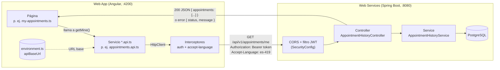

# FisioVital Web App

Web App de FisioVital (Sprint 2, TB3 de 1ACC0236 Ingeniería de Software, UPC 2026-20). Angular 22, TypeScript y
Angular Material 3, integrada con [fisiovital-web-services](https://github.com/Ravit18/fisiovital-web-services).

## Requisitos

- Node.js 22 o superior (probado con 24) y npm.
- El backend corriendo en `http://localhost:8080` (ver su README). Ya acepta CORS desde `http://localhost:4200`.

## Cómo correr

```bash
npm install
npm start          # http://localhost:4200
npm test           # Vitest
npm run build      # dist/fisiovital-web-app
```

La URL del backend está en `src/environments/environment.ts` (`apiBaseUrl`).

## Cómo se conecta con el backend

La Web App no guarda datos propios: todo lo pide al backend por HTTP (JSON) y solo dibuja la respuesta.



Las piezas que hacen la conexión:

| Pieza | Archivo | Qué hace |
|---|---|---|
| Dirección del backend | `src/environments/environment.ts` | `apiBaseUrl = http://localhost:8080/api/v1`. Para la nube (TB4) solo se cambia aquí. |
| Servicios de API | `<contexto>/services/*.api.ts` | Un método por endpoint, por ejemplo `getMine()` → `GET /appointments/me`. Son los únicos que usan `HttpClient`. |
| Modelos | `<contexto>/model/*.entity.ts` | Interfaces con los mismos campos que los `*Resource` del backend, así el JSON calza directo. |
| Token | `iam/services/auth.interceptor.ts` | Agrega `Authorization: Bearer <token>` a cada llamada. Si el backend responde 401, cierra la sesión. |
| Idioma | `shared/interceptors/accept-language.interceptor.ts` | Envía `Accept-Language` (es-419/en-US) y el backend responde los mensajes en ese idioma. |
| Registro de interceptores | `src/app/app.config.ts` | `provideHttpClient(withInterceptors([...]))`. |
| Permiso del navegador (CORS) | Backend: `SecurityConfig.java` y `app.cors.allowed-origins` | Deja que `localhost` (cualquier puerto) llame a la API. En la nube se fija con `CORS_ALLOWED_ORIGINS`. |

Cada servicio del front corresponde a un controller del backend:

| Front (`*.api.ts`) | Backend (controller) | US |
|---|---|---|
| `iam/services/auth.service.ts` | `AuthController` (`/auth`) | US01–US03 |
| `profiles/services/physiotherapists.api.ts` | `PhysiotherapistController` (`/physiotherapists`) | US04–US05 |
| `scheduling/services/slots.api.ts` | `PhysiotherapistController` (`/{id}/slots`) y `MySlotsController` | US06–US07 |
| `treatment/services/agenda.api.ts` | `AgendaController` | US08 |
| `treatment/services/treatment-plans.api.ts` | `TreatmentPlanController` | US09–US10 + CRUD del plan (GET/PUT/DELETE `{id}`) |
| `treatment/services/sessions.api.ts` | `SessionController` | US11–US12 |
| `notifications/services/notifications.store.ts` | `NotificationController` | US13 |
| `appointments/services/appointments.api.ts` | `AppointmentHistoryController` | US14–US16 |
| `assistant/services/assistant.api.ts` | `AssistantController` | US17–US20 |

Para verlo en vivo, abre la app, presiona **F12 → Network (Red)**, filtra por `api/v1` y navega: cada fila es una
llamada al backend, con su URL, sus headers (token e idioma) y el JSON de respuesta.

**Si sale "No pudimos conectar con el servidor":** el backend no está corriendo en `:8080`, o la página se abrió
desde un origen que el CORS no permite. Revisa primero que `http://localhost:8080/swagger-ui.html` abra.

## Estructura

Igual que el backend, por bounded context. Cada contexto tiene `model/` (interfaces de los recursos), `services/`
(llamadas HTTP, guards, interceptors), `components/` y `pages/` (componentes enrutables).

| Contexto | Contenido |
|---|---|
| `iam` | Sesión y JWT (`AuthService`, `authInterceptor`), `authGuard`/`guestGuard`/`roleGuard`, sign-in y sign-up |
| `profiles` | Búsqueda por especialidad y perfil del fisioterapeuta con plan y reserva |
| `scheduling` | Selector de horarios libres por semana (`SlotPicker`) y publicación de horarios |
| `treatment` | Planes, reserva, reprogramar (diálogo) y cancelar; agenda del fisioterapeuta |
| `notifications` | `NotificationsStore` (campana con no leídas) y página de notificaciones |
| `appointments` | Mis citas del paciente (paginado) e historial de pacientes del fisioterapeuta |
| `assistant` | Chat con el asistente IA (mantiene `conversationId`) |
| `shared` | Layout, idioma, diálogo de confirmación, snackbar de avisos, utilidades de fechas, Home, Términos y 404 |

## Historias de usuario en la Web App

| US | Rol | Dónde |
|---|---|---|
| `iam` | US01–US03 | Sesión (`AuthService`), JWT (`authInterceptor`), `authGuard`/`guestGuard`, página de sign-in |
| `profiles` | US04–US05 | — |
| `scheduling` | US06–US07 | — |
| `treatment` | US08–US12 | — |
| `notifications` | US13 | — |
| `appointments` | US14–US16 | — |
| `assistant` | US17–US20 | — |
| `shared` | — | Landing pública, layout, idioma, panel del paciente con planes/progreso/notificaciones reales, Términos y 404 |
| US01 Registro de paciente | Visitante | `/sign-up` (Paciente); entra directo al terminar |
| US02 Registro de fisioterapeuta | Visitante | `/sign-up` (Fisioterapeuta): colegiatura, especialidad, experiencia |
| US03 Inicio de sesión (bloqueo tras 5 intentos) | Visitante | `/sign-in`; muestra el mensaje del backend |
| US04 Buscar por especialidad | Paciente | `/physiotherapists` |
| US05 Perfil del fisioterapeuta | Paciente | `/physiotherapists/:id` |
| US06 Horarios libres / siguiente semana disponible | Paciente | Perfil → "Horarios disponibles" |
| US07 Publicar horarios | Fisioterapeuta | `/availability` |
| US08 Agenda diaria | Fisioterapeuta | `/agenda` |
| US09 Plan de tratamiento | Paciente | Perfil → "Tu plan de tratamiento"; `/treatment-plans` (editar y eliminar plan) |
| US10 Reservar sesión (409 si otro la tomó) | Paciente | Perfil → elegir horario → confirmar |
| US11 Reprogramar (cambio tardío < 24 h) | Paciente | `/appointments` → Reprogramar |
| US12 Cancelar (`LATE_CANCELLED` < 24 h) | Paciente | `/appointments` → Cancelar |
| US13 Notificaciones y recordatorios | Ambos | Campana de la barra y `/notifications` |
| US14 Historial del paciente (paginado, 503) | Paciente | `/appointments` (Próximas / Historial, "Cargar más") |
| US15 Historial del fisioterapeuta | Fisioterapeuta | `/patients` |
| US16 Historial de un paciente | Fisioterapeuta | `/patients` → buscar por nombre completo |
| US17–US20 Asistente IA (dudas, especialista, reservar, reprogramar) | Ambos (reservar y reprogramar: paciente) | `/assistant` |

## i18n y accesibilidad

- Idiomas `es-419` (por defecto) y `en-US` con ngx-translate. Los textos están en `public/i18n/*.json`; usar siempre
  claves (`{{ 'iam.signIn.title' | translate }}`), nunca texto fijo en las plantillas.
- `acceptLanguageInterceptor` envía el idioma elegido en `Accept-Language`, así los errores del backend
  (`{status, message, details}`) llegan ya traducidos y se muestran tal cual.
- ARIA: enlace "Saltar al contenido", `aria-label` en botones de solo ícono, `role="alert"` en errores y
  `<html lang>` sincronizado con el idioma.

## Cuentas de prueba

El backend arranca sin datos. Para crear estas cuentas con sus horarios, planes y citas, corre una vez en
`fisiovital-web-services` (con el backend encendido):

```bash
powershell -ExecutionPolicy Bypass -File scripts\seed-demo.ps1
```

Todas usan la contraseña **`Demo2026*`**. Son datos ficticios solo para desarrollo local (correos `@example.com`).

| Rol | Correo | Qué vas a ver |
|---|---|---|
| Paciente | `carlos.mendoza@example.com` | 6 citas con dos fisioterapeutas (Mariana y Jorge) |
| Paciente | `ana.torres@example.com` | Citas próximas y canceladas en el historial |
| Paciente | `luis.quispe@example.com` | Una cita reprogramada |
| Paciente | `sofia.huaman@example.com` | Plan de rehabilitación neurológica de 20 sesiones |
| Fisioterapeuta | `mariana.rojas@example.com` | Agenda con Carlos y Ana (deportiva) |
| Fisioterapeuta | `jorge.paredes@example.com` | Agenda con Carlos y Luis (columna y postura) |
| Fisioterapeuta | `lucia.vargas@example.com` | Agenda con Sofía (neurológica) |

Los horarios se publican desde el día siguiente a la carga: en **Mi agenda** usa "Semana siguiente" si hoy
aparece vacío.
